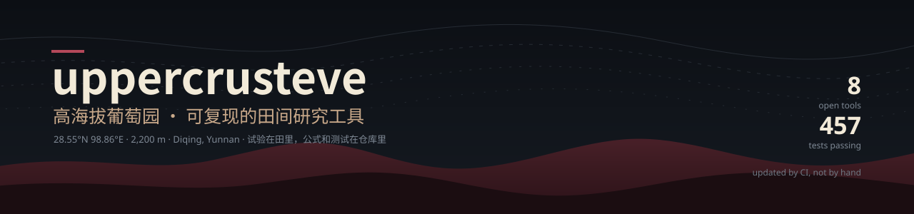

做信息化：定时采集、数据清洗、流水线门禁。工具是我干活的法子——每道容易出错的工序先手工做一遍，再固化成能复算、能测、断在哪能续跑的代码。夜里机器空着就跑采集和校验，白天只处理需要人判断的那一小截。

手上三块：夜间空窗里跑的采集—筛选—校验—发布流水线；多源抓取、编码清洗与快照留档，源挂了标记不停机；单位侧的网络与模型网关接入、环境核验、账号和元数据整理。

工具全部 MIT、带测试、写明边界。哪个不好用或者数字不对，直接开 issue。

[液态玻璃站](https://uppercrusteve.github.io/liquid-glass-profile/) · [夜班流水线](#夜班流水线) · [抓取与清洗](#抓取与清洗) · [写作与文档](#写作与文档) · [日常小工具](#日常小工具) · [开 issue](https://github.com/uppercrusteve/ams-check/issues)

## 夜班流水线

深夜机器空着的那几个小时，自动跑一遍：扫 GitHub 上的东西 → 打分筛 → 转化成一个可开源的小工具 → 校验 → 推仓库并挂到这页。只在北京时间 01:00–06:00 且机器空闲时动，白天手动跑要显式放行。

硬门禁在前：三关不过就整晚跳过，不硬跑。判定只认硬信号——测试全绿、有来源说明、slug 合法、没发过、同名仓库不存在，五条同时满足才发，一晚最多两条。任何一步失败记断点和错误，仓库建成而主页没挂上，下次只补主页不重建。打分侧另有去重指纹：同一个仓下轮 star 没涨两成就扣分，旧闻自然沉底。

下面是它 2026-11-25 夜里自己发出来的三件东西。

<!-- autopub:begin 下面到 autopub:end 之间的条目由 nightshift 流水线夜里自动追加；只插新的，不改已有条目，手改也安全 -->

### [forge-lint](https://github.com/uppercrusteve/forge-lint)

给「一夜之间攒出来的 skill / 工具目录」做体检。规则来自真实出事点，不来自想象。夜班流水线 2026-11-25 自动产出，未过人工过目。

```bash
python lint.py ../some-skill-dir            # 人读清单
```


### [stage-ckpt](https://github.com/uppercrusteve/stage-ckpt)

给夜间流水线的阶段加「步级断点」：断在哪步，下个窗口从哪步续。夜班流水线 2026-11-25 自动产出，未过人工过目。

```bash
bash example/run-digest.sh
```


### [score-bench](https://github.com/uppercrusteve/score-bench)

一个打分器的排序回归台。给人已经挑过的正例和已经扔掉的负例，量出「谁压着谁」。夜班流水线 2026-11-25 自动产出，未过人工过目。

```bash
python bench.py                    # 默认跑 scorer/score.py，过闸返回 0
```


### [geom-lint](https://github.com/uppercrusteve/geom-lint)

把「版面歪了」变成一组能进 CI 的几何谓词。给一张带显式坐标的 HTML/SVG，它按事先固定的参考线逐条判：边缘有没有落在列上、文字有没有离基线、间距是不是节奏的整数倍、块有没有压进 gutter、有没有不明重叠、有没有出画布。每条都指到元素、报出像素差，最后给分和退出码。夜班流水线 2026-11-26 自动产出，未过人工过目。

```bash
python -m geomlint --print-guides --width 1280 --height 800 --cols 12 --margin 40 --gutter 24 > guides.json
```


### [skillcc](https://github.com/uppercrusteve/skillcc)

一份 skill 源码，编译出多个 harness 的副本，并用内容哈希确认副本没被手改过。夜班流水线 2026-11-26 自动产出，未过人工过目。

```bash
python -m skillcc build                       # 校验 + 写 dist/
```


### [upstream-gate](https://github.com/uppercrusteve/upstream-gate)

把一个候选目录的 `upstream.md` 当合同来审：借鉴了谁、什么许可、能不能搬代码、我们到底改了什么。夜班流水线 2026-11-26 自动产出，未过人工过目。

```bash
python -m upstream_gate path/to/candidate          # 判定
```


### [entry-lint](https://github.com/uppercrusteve/entry-lint)

审 skill 包的**入口面**：slash 入口是不是只收窄参数，检查项有没有真的落到 skill 文件里。夜班流水线 2026-11-27 自动产出，未过人工过目。

```bash
python -m entrylint path/to/pkg                 # 人看的判定
```


### [manifest-lint](https://github.com/uppercrusteve/manifest-lint)

装之前先问一句：这个 skill 背着你联网了吗、读凭据了吗、调了你机器上没有的命令？夜班流水线 2026-11-27 自动产出，未过人工过目。

```bash
python -m manifest path/to/pkg                     # 判定
```

<!-- autopub:end -->

## 抓取与清洗

抓取一律先落原始快照再解析，解析失败留原文件，不丢证据。控制台编码是 GBK，中文载荷一律走 UTF-8 文件；图片源靠视觉模型读，读错了不会自己报错，所以拿场次号和时刻做二次校验兜底。源分可用、阻塞两档，阻塞的直接标 `source_status=blocked`，报告照出并注明缺几源——不为了齐整把流程挂死。

调度走系统计划任务，每次先判同槽位十分钟内是否跑过、代理通不通，再决定跑还是退。日志按天按槽落 UTF-8 文件，跑完逐项验产物，缺一个就返回非零。

## 写作与文档

- **[thesis-forge](https://github.com/uppercrusteve/thesis-forge)** Markdown 转 A4 学位论文 DOCX：样式、目录域、三线表、题注，外加一次格式体检。
- **[citecheck-zh](https://github.com/uppercrusteve/citecheck-zh)** 中文稿件的引文与文献表对账：悬空引用、孤立文献、编号断档、坏 DOI，定位到行号。

## 日常小工具

不搭边，谁都能用。

### [高原徒步助手](https://uppercrusteve.github.io/ams-check/)

点开就用，装到桌面后没信号也能开。按昨晚睡眠海拔和今天的最高海拔算净上升，再走一遍 Lake Louise 自评；红旗项一勾，直接判下撤。数据只留本机，不登录。线路海拔是参考值、没有实测，页面里写着来源和核实日期。

### [zh-punct](https://github.com/uppercrusteve/zh-punct)

查中文排版里机器判得准的硬伤：全半角混用、成对符号不闭合、标点连写、`...` 当省略号。代码块、URL、文献行先掩掉再判，误报优先压下去；`--fix` 只落无歧义的那几条。

```bash
pipx install git+https://github.com/uppercrusteve/zh-punct
zh-punct draft.md
```

## 最近发布

<!-- releases:start -->
- [zh-punct v0.1.0](https://github.com/uppercrusteve/zh-punct/releases/tag/v0.1.0) — 2026-11-19
- [ams-check v0.1.0](https://github.com/uppercrusteve/ams-check/releases/tag/v0.1.0) — 2026-11-19
- [thesis-forge v0.1.0](https://github.com/uppercrusteve/thesis-forge/releases/tag/v0.1.0) — 2026-11-18
- [citecheck-zh v0.1.0](https://github.com/uppercrusteve/citecheck-zh/releases/tag/v0.1.0) — 2026-11-18
<!-- releases:end -->

## 怎么做事

口径冲突就并排放着，不取平均；公开数据带来源和检索日期，直链失效也留标题；合成演示只用来跑通流程，首屏标注；网格值和实测分开写。每个仓库都有方法说明和「它不干什么」一节。

<sub>数据卡与上面的发布列表由 [`.github/workflows/stats.yml`](./.github/workflows/stats.yml) 每天抓 GitHub API 生成；头图是手写 SVG，其中两个数字同样由该任务改写，玻璃质感与 [液态玻璃站](https://uppercrusteve.github.io/liquid-glass-profile/) 同源。示例除注明出处外均为合成数据，`ams-check` 的线路海拔是参考值。</sub>


