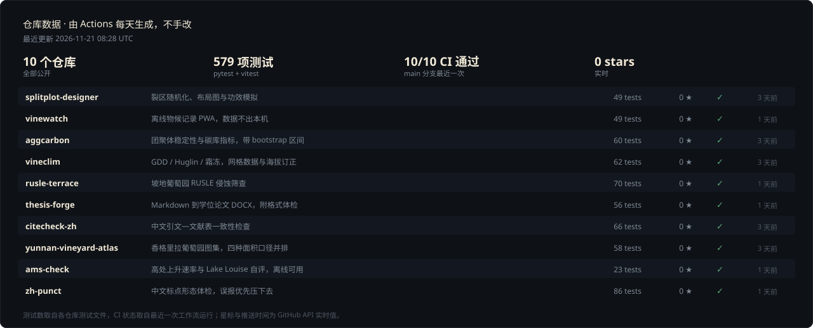

在云南德钦、香格里拉一带做高海拔葡萄园的田间研究。写工具是我干活的法子：每道容易出错的工序，先手工做一遍，再固化成能复算、能测的东西。研究和生活两边都是这个路子，区别只是另一半跟论文无关。

工具全部 MIT、带测试、写明边界。哪个不好用或者数字不对，直接开 issue。

<samp>
<nobr><a href="https://uppercrusteve.github.io/yunnan-vineyard-atlas/">数据图集</a></nobr> ·
<nobr><a href="#研究工具">研究工具</a></nobr> ·
<nobr><a href="#日常小工具">日常小工具</a></nobr> ·
<nobr><a href="https://github.com/uppercrusteve/ams-check/issues">报问题</a></nobr>
</samp>

## 日常小工具

跟葡萄园没关系，谁都能用。

### [高原徒步助手](https://uppercrusteve.github.io/ams-check/)

点开就用，装到桌面后没信号也能开。按昨晚睡眠海拔和今天的最高海拔算净上升，再走一遍 Lake Louise 自评；红旗项一勾，直接判下撤。数据只留本机，不登录。线路海拔是参考值、没有实测，页面里写着来源和核实日期。

### [zh-punct](https://github.com/uppercrusteve/zh-punct)

查中文排版里机器判得准的硬伤：全半角混用、成对符号不闭合、标点连写、`...` 当省略号。代码块、URL、文献行先掩掉再判，误报优先压下去；`--fix` 只落无歧义的那几条。

```bash
pipx install git+https://github.com/uppercrusteve/zh-punct
zh-punct draft.md
```

## 研究工具

前两条点开就能用。其余 `git clone` 后装，三条命令内出结果。

- **[藤候 VineWatch](https://uppercrusteve.github.io/vinewatch/)** 离线物候（BBCH）记录。山里没信号也能记，照片本地压缩，随时导出 CSV / GeoJSON。
- **[云岭之上 · 图集](https://uppercrusteve.github.io/yunnan-vineyard-atlas/)** 德钦葡萄园数据图集。同年四种面积口径并排，不取平均，每条数字带出处与检索日期。
- **[splitplot-designer](https://github.com/uppercrusteve/splitplot-designer)** 裂区试验的随机化、布局图与功效模拟。主区效应用 `block×main` 误差层检验，不把采样点当重复。
- **[aggcarbon](https://github.com/uppercrusteve/aggcarbon)** 团聚体湿筛的 MWD、GMD、R>0.25、ESM 校正储量、POC/MAOC 分组，带块 bootstrap 区间。
- **[vineclim](https://github.com/uppercrusteve/vineclim)** GDD、Huglin、冷夜、霜冻日历。NASA POWER 拉取，未订正与海拔订正双列对照。
- **[rusle-terrace](https://github.com/uppercrusteve/rusle-terrace)** DEM 驱动的坡地葡萄园 RUSLE 筛查：坡度分级、D8 汇流、风险图。缺米制 CRS 直接报错。
- **[thesis-forge](https://github.com/uppercrusteve/thesis-forge)** Markdown 转 A4 学位论文 DOCX：样式、目录域、三线表、题注，外加一次格式体检。
- **[citecheck-zh](https://github.com/uppercrusteve/citecheck-zh)** 中文稿件的引文与文献表对账：悬空引用、孤立文献、编号断档、坏 DOI，定位到行号。

## 最近发布

<!-- releases:start -->
- [zh-punct v0.1.0](https://github.com/uppercrusteve/zh-punct/releases/tag/v0.1.0) — 2026-11-19
- [ams-check v0.1.0](https://github.com/uppercrusteve/ams-check/releases/tag/v0.1.0) — 2026-11-19
- [yunnan-vineyard-atlas v0.1.0](https://github.com/uppercrusteve/yunnan-vineyard-atlas/releases/tag/v0.1.0) — 2026-11-18
- [vinewatch v0.1.0](https://github.com/uppercrusteve/vinewatch/releases/tag/v0.1.0) — 2026-11-18
- [vineclim v0.1.0](https://github.com/uppercrusteve/vineclim/releases/tag/v0.1.0) — 2026-11-18
<!-- releases:end -->

## 怎么做事

口径冲突就并排放着，不取平均；公开数据带来源和检索日期，直链失效也留标题；合成演示只用来跑通流程，首屏标注；网格气候值和园地实测分开写。每个仓库都有方法说明和「它不干什么」一节。

<sub>数据卡与上面的发布列表由 [`.github/workflows/stats.yml`](./.github/workflows/stats.yml) 每天抓 GitHub API 生成；头图是手写 SVG，其中两个数字同样由该任务改写。示例除注明出处外均为合成数据，`ams-check` 的线路海拔是参考值。</sub>


