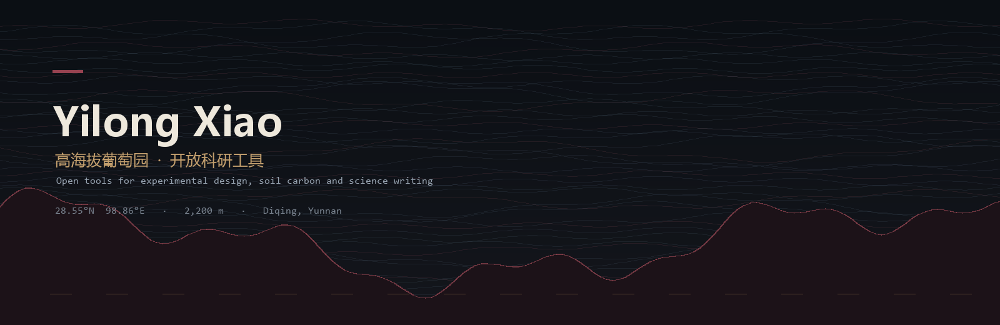

**高海拔葡萄园研究 / 开放科研工具**

硕士研究生，西北农林科技大学葡萄酒学院。研究香格里拉干热河谷葡萄园的行间生草、叶幕管理与土壤有机碳。喜欢把重复劳动做成小而可靠的工具，也喜欢把数据口径讲清楚。

- 🔬 田间：裂区试验设计、团聚体与有机碳、模拟降雨、物候观测
- 🛠 工程：Python 科研栈、GIS 栅格分析、原生 Web/PWA、可复现文档
- 📍 云南迪庆 · 香格里拉产区

## 在做的事

把研究流程拆成可测试的环节：

**设计** → [splitplot-designer](https://github.com/uppercrusteve/splitplot-designer) · [vinewatch](https://github.com/uppercrusteve/vinewatch)
**分析** → [aggcarbon](https://github.com/uppercrusteve/aggcarbon) · [vineclim](https://github.com/uppercrusteve/vineclim) · [rusle-terrace](https://github.com/uppercrusteve/rusle-terrace)
**写作** → [thesis-forge](https://github.com/uppercrusteve/thesis-forge) · [citecheck-zh](https://github.com/uppercrusteve/citecheck-zh)
**传播** → [yunnan-vineyard-atlas](https://github.com/uppercrusteve/yunnan-vineyard-atlas)

## 数据原则

公开数据标来源，冲突口径并列；合成数据标演示；网格值不冒充园地实测；每个工具都写局限。

## 工具

---

Open tools for highland vineyard research. Every repo ships with tests, method notes and stated limits.
